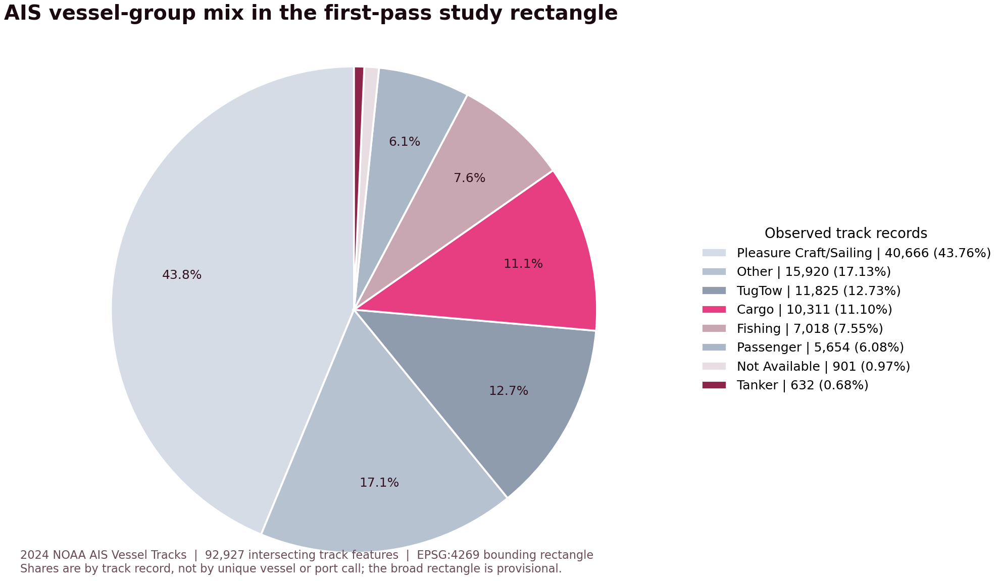

# Proposal Presentation Manuscript — Version 2 Additions

This file contains **only the slides added to** [`1st_Proposal_manuscript_codex.md`](1st_Proposal_manuscript_codex.md). The original Version 1 slides are not repeated here. Insert the additions at the locations noted below when updating the deck.

> **Scope of the preliminary AIS figures:** Counts below were calculated from the 2024 GeoPackage layer after selecting tracks whose geometries intersect the provisional rectangle `−77.0 ≤ longitude ≤ −75.5`, `36.3 ≤ latitude ≤ 37.5` (EPSG:4269). This is a broad screening extent, not a finalized navigational boundary. A track row is not the same as a unique vessel, port call, or transit event. Replace the regional figures after the team approves its final boundary.

---

## Added Slide A — Who Uses the Study-Area Waters?

**Insert after Version 1, Slide 5 — AIS Data Overview.**

### Headline

**Cargo and tanker tracks are a focused study group within a mixed-use waterway.**

### On-slide text

- The provisional study rectangle contains **92,927 intersecting track features** across eight observed NOAA `VesselGroup` values.
- `Pleasure Craft/Sailing` is the largest group by track rows (43.76%); `Other` is 17.13%, and `TugTow` is 12.73%.
- `Cargo` accounts for **11.10%** and `Tanker` for **0.68%** of track rows in this rectangle.
- Cargo and tanker are selected because the proposal asks how these two commercial vessel groups use and share port approaches—not because they dominate all observed traffic.

### Regional distribution by track feature

| NOAA `VesselGroup` | Track rows | Share of rows | Distinct MMSIs in group |
|---|---:|---:|---:|
| Pleasure Craft/Sailing | 40,666 | 43.76% | 4,713 |
| Other | 15,920 | 17.13% | 453 |
| TugTow | 11,825 | 12.73% | 321 |
| Cargo | 10,311 | 11.10% | 1,865 |
| Fishing | 7,018 | 7.55% | 306 |
| Passenger | 5,654 | 6.08% | 99 |
| Not Available | 901 | 0.97% | 98 |
| Tanker | 632 | 0.68% | 138 |
| **Total** | **92,927** | **100.00%** | — |

`Distinct MMSIs in group` is calculated separately within each group; it is not additive across rows. `Other` combines a wide variety of vessel classifications, while `Not Available` reflects unavailable or undefined type information. NOAA describes `VesselGroup` as a grouping built from AIS vessel-type codes and notes that `Other` is heterogeneous. [NOAA AIS FAQ and vessel-group guidance](https://coast.noaa.gov/data/marinecadastre/ais/faq.pdf)

In plain terms, the other observed groups are: `Pleasure Craft/Sailing` (pleasure and sailing classifications), `TugTow` (tugs and towing classifications), `Fishing`, `Passenger`, the heterogeneous `Other` group, and `Not Available`. These are source AIS group labels; they do not independently verify a vessel’s actual voyage purpose.

Supporting count table: [`data/interim/ais_vesselgroup_bbox_summary_2024.csv`](../data/interim/ais_vesselgroup_bbox_summary_2024.csv).

### Why focus on Cargo and Tanker?

The proposal’s research questions explicitly compare cargo-vessel and tanker use areas and their monthly patterns. Those two groups also connect the analysis to the region’s commercial cargo activity. The focus is therefore a **question-driven scope choice**. The pie chart makes clear that the resulting analysis will not describe all traffic in the shared waterway; pleasure craft, tug/tow, fishing, passenger, and other vessels remain important context and may be considered in later work.

The source label is `Cargo`, not `Bulk_Carrier`. `Cargo` is a broad AIS category and must not be presented as a bulk-carrier-only sample. If the team intends to study bulk carriers specifically, it should identify a validated narrower `VesselType` mapping or combine the AIS data with a vessel registry before making that claim.

### Figure

**Figure caption:** Share of track features whose full source geometry intersects the provisional rectangle, by source `VesselGroup`. The slices represent track rows, not unique vessels or port calls. Tracks were tested for intersection but were not clipped to the rectangle. The source geometry uses EPSG:4269.

### Speaker notes

Explain that repeated tracks from one MMSI contribute multiple rows. The chart answers “what share of the extracted track records falls in each source group?”; it does not estimate a vessel fleet share, annual port-call share, or percentage of cargo tonnage. The regional rectangle is temporary and should be replaced with the agreed study boundary before final reporting.

---

## Added Slide B — Why Norfolk / Hampton Roads?

**Insert after Version 1, Slide 3 — Problem and Motivation.**

### Headline

**A major commercial gateway with busy, shared approaches and a clear traffic-management question.**

### On-slide text

- **A large cargo gateway:** USACE reported **68.8 million short tons** of waterborne cargo for the Port of Virginia statistical area in calendar year 2023, ranking it **9th among U.S. ports** by total tonnage.
- **Substantial container and vessel activity:** In Port of Virginia fiscal year 2024 (July 1, 2023–June 30, 2024), the port handled **3,499,639 TEUs**, **283,817 tons of breakbulk cargo**, and **1,733 ship calls**.
- **Approach-channel relevance:** In 2024, the Port of Virginia opened a wider channel for two-way passage of ultra-large container vessels; the port reported that this could reduce a large vessel’s time at berth by up to 15%.
- **A useful case for spatial comparison:** Cargo vessels and tankers operate within a harbor also used by recreational, tug/tow, fishing, and passenger traffic, making their spatial use and monthly variation meaningful to examine.

### Suggested visual layout

Use a locator map from the U.S. East Coast to Chesapeake Bay and Norfolk/Hampton Roads, with the Norfolk Harbor/approach channel and Port of Virginia’s regional terminals labeled. Add three metric cards: `68.8M short tons · CY2023`, `3.50M TEUs · FY2024`, and `1,733 ship calls · FY2024`. Keep cargo tonnage, container throughput, and ship calls labeled as separate measures.

### Speaker notes

Hampton Roads is a regional harbor and port complex; the Port of Virginia is the commercial gateway associated with the study area. Port-wide totals establish the area’s commercial importance, but they do not describe only the provisional AIS rectangle. The USACE tonnage statistic is for calendar 2023 and its statistical port area; the Port of Virginia statistics are for fiscal 2024, ending June 30, 2024; this project’s AIS tracks cover calendar 2024. These different periods and measurement units provide context and must not be treated as a direct one-to-one validation of the AIS counts.

The port’s 2024 wider-channel milestone is relevant because the project examines vessel movement through port approaches. It does not by itself establish a safety risk or prove that one vessel group needs more monitoring.

### Sources for the slide

1. U.S. Army Corps of Engineers, *The U.S. Coastal and Inland Navigation System: 2023 Transportation Facts and Information* (published March 2025), “Leading U.S. Ports in 2023”: Port of Virginia ranked 9th, with 68.8 million short tons total (64.7 million foreign; 4.0 million domestic, rounded). [Fact card PDF](https://publibrary.sec.usace.army.mil/api/download?filename=FactCard2023.pdf&id=0aab3c03-f568-4c93-a08c-1e681954fa84&preview=true).
2. The Port of Virginia, “Virginia Completes FY 2024 with Growth in Cargo Volumes and Progress on Infrastructure Projects,” July 30, 2024. [FY2024 results](https://www.portofvirginia.com/news/virginia-completes-fy-2024-with-growth-in-cargo-volumes-and-progress-on-infrastructure-projects/).
3. The Port of Virginia, “Virginia Opens Wider Channel; Now Supports Two-Way Ultra-Large Container Vessel Movement,” March 1, 2024. [Channel milestone](https://www.portofvirginia.com/news/virginia-opens-wider-channel-now-supports-two-way-ultra-large-container-vessel-movement/).

---

## Added Slide C — Why Resolution Matters?

**Insert after Version 1, Slide 6 — Data Preparation and Analysis Design.**

### Headline

**Grid size changes what counts as a local hotspot—and how much computation the analysis needs.**

### On-slide comparison

| Grid cell | Cell area | Cells per 1 km² | What it can show | Main trade-off |
|---|---:|---:|---|---|
| **250 m** | 62,500 m² (0.0625 km²) | 16 | Finer local variation and narrower route corridors | More cells, sparse counts, and potentially fragmented hotspot patterns |
| **500 m** | 250,000 m² (0.25 km²) | 4 | Intermediate spatial detail for the primary analysis | Balances detail and stability, but may still merge nearby routes or split a broad pattern |
| **1 km** | 1,000,000 m² (1 km²) | 1 | Broad traffic concentrations and a smoother overview | Fewer cells and lower processing burden, but distinct corridors can be merged and local variation hidden |

### Takeaway

**Finer resolution gives more spatial detail; it does not automatically give more accurate results.** A 250 m grid can separate nearby patterns that a 1 km grid blends, but it also creates 16 times as many theoretical cells per square kilometre and can produce sparse, unstable counts. A 1 km grid is computationally lighter for the same area but can conceal narrower corridors. Actual runtime depends on the study boundary, track geometries, occupied cells, and implementation.

### Planned comparison method

- Use the **500 m grid** as the primary setting, as specified in Version 1.
- Repeat with **250 m and 1 km** grids and compare the selected areas on a common spatial reference.
- Use unique MMSIs per cell, with the proposal’s top-10% occupied-cell rule as the primary selection and top 20% as a sensitivity case.
- Report overlap and location changes across resolutions. Do not treat counts summed across neighboring cells as unique vessels for the whole study area: one track or MMSI can intersect multiple cells.

### Figure placeholder

`[PLACEHOLDER: three side-by-side panels at the same map extent, showing one AIS track sample over 250 m, 500 m, and 1 km grids; use one shared legend and equal scale. Add observed cell counts and selected-cell overlays only after running the analysis.]`

### Speaker notes

Grid size is a scale choice. The appropriate setting depends on the question, boundary size, route spacing, and positional/data-processing characteristics. The proposed comparison tests whether the monitoring candidates remain similar as the scale changes; it does not assume in advance that the finest grid is best or that the coarsest grid is inaccurate.

---

## References for the added slides

- NOAA Office for Coastal Management. [AIS Vessel Tracks 2024 metadata](https://www.fisheries.noaa.gov/inport/item/75937); [AIS data FAQ and vessel type/group guidance](https://coast.noaa.gov/data/marinecadastre/ais/faq.pdf).
- U.S. Army Corps of Engineers, Navigation and Civil Works Decision Support Center. [2023 U.S. port statistics fact card](https://publibrary.sec.usace.army.mil/api/download?filename=FactCard2023.pdf&id=0aab3c03-f568-4c93-a08c-1e681954fa84&preview=true).
- The Port of Virginia. [FY2024 cargo results](https://www.portofvirginia.com/news/virginia-completes-fy-2024-with-growth-in-cargo-volumes-and-progress-on-infrastructure-projects/); [2024 two-way channel milestone](https://www.portofvirginia.com/news/virginia-opens-wider-channel-now-supports-two-way-ultra-large-container-vessel-movement/).
