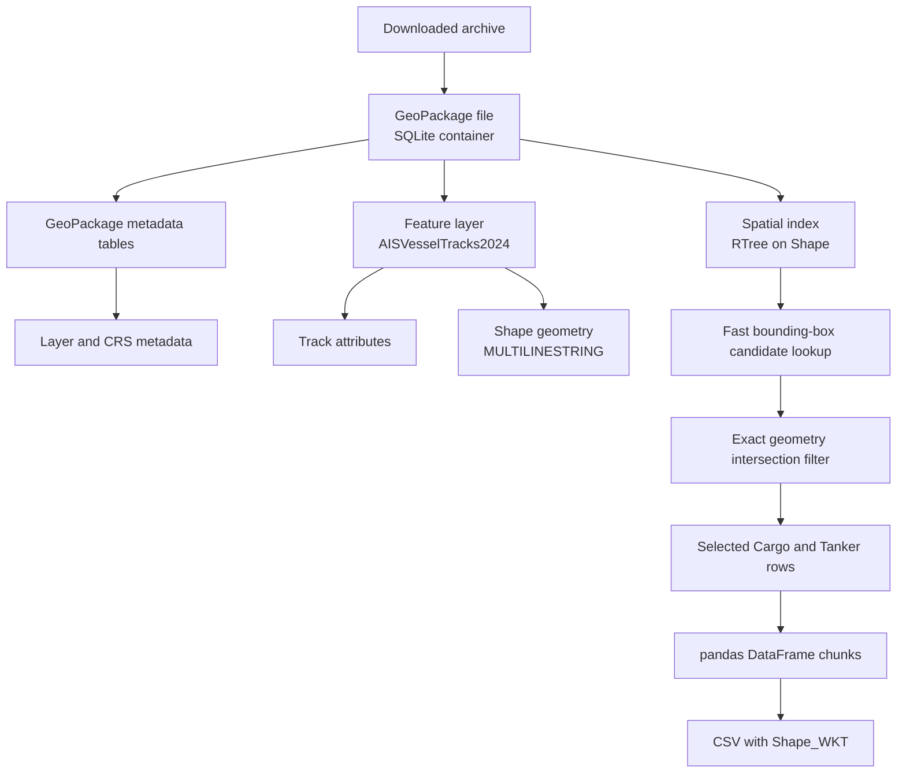
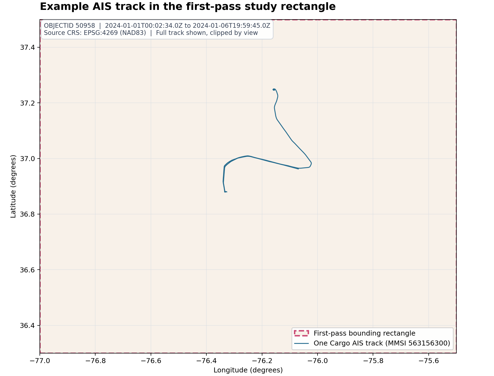

# AIS Vessel Tracks 2024: Data Structure and First-Pass Extract

## What is in the source file?

`AISVesselTracks2024.gpkg` is a GeoPackage: a SQLite database that stores spatial features, descriptive fields, coordinate-system metadata, and spatial indexes. Its feature layer is named `AISVesselTracks2024`. Each feature row represents a vessel track for a time interval; a vessel identified by an MMSI can therefore appear in many rows.



The `Shape` column is stored as GeoPackage geometry binary, not as ordinary text. The CSV extract converts it to WKT (Well-Known Text) in `Shape_WKT`, so the output can be opened by standard tabular tools. The geometry coordinates use **EPSG:4269 (NAD83 longitude/latitude)**.

## Example GIS view

The image below plots one `Cargo` track from the extract. The dashed rectangle is the temporary first-pass filter area. The axes show longitude and latitude in the source CRS; there is no basemap or coastline layer in this example.



The plotted feature is `OBJECTID 50958` (`MMSI 563156300`). The full source track is shown within the plotted view; the line was not clipped in the CSV.

To reproduce this individual record on another computer, use [`example_trace.csv`](../data/interim/example_trace.csv) and its [`example_trace_metadata.json`](../data/interim/example_trace_metadata.json) sidecar. The CSV preserves the track as WKT in EPSG:4269 and includes the map extent. No coastline layer was present in the AIS GeoPackage or project workspace, so the example figure contains no coastline geometry.

## Layer fields

| Field | Source type | Meaning / use |
|---|---|---|
| `OBJECTID` | Integer | Unique feature-row identifier; also used by the spatial index. |
| `Shape` | MultiLineString geometry | Vessel track linework. A track may contain multiple line parts. |
| `MMSI` | Medium integer | Maritime Mobile Service Identity; a vessel identifier that may recur across track rows. |
| `TrackStartTime` | Date/time | Start time of the recorded track interval. |
| `TrackEndTime` | Date/time | End time of the recorded track interval. |
| `VesselType` | Medium integer | Numeric vessel-type code. A codebook should be consulted before assigning human-readable meanings. |
| `Length` | Double | Vessel length as supplied in the source. |
| `Width` | Double | Vessel width as supplied in the source. |
| `Draft` | Double | Vessel draft as supplied in the source. |
| `DurationMinutes` | Medium integer | Duration of the track interval in minutes. |
| `VesselGroup` | Text (up to 25 characters) | Broad source category such as `Cargo`, `Tanker`, `Fishing`, or `Passenger`. |

The source layer has an RTree index named `rtree_AISVesselTracks2024_Shape`. It lets SQLite quickly find geometries whose bounding boxes might overlap a search rectangle. The extract then checks the actual geometry against that rectangle, removing bounding-box-only false positives.

## First-pass extract

The first extract is saved at:

[`data/interim/norfolk_hampton_roads_cargo_tanker_bbox_2024.csv`](../data/interim/norfolk_hampton_roads_cargo_tanker_bbox_2024.csv)

| Setting | Value |
|---|---|
| Geographic filter | Rectangle from longitude −77.0 to −75.5 and latitude 36.3 to 37.5, in EPSG:4269 |
| Geometry rule | Keep tracks whose geometry intersects the rectangle |
| Vessel groups | `Cargo`, `Tanker` |
| Extracted rows | 10,943 total |
| `Cargo` rows / distinct MMSIs | 10,311 / 1,865 |
| `Tanker` rows / distinct MMSIs | 632 / 138 |
| CSV size | About 373 MB |

The rectangle is a **temporary broad study-area filter**, not a finalized port boundary or chart-derived study boundary. Its use is to make an initial, manageable tabular extract. Tracks crossing the rectangle edge are retained as complete source geometries; the linework is not clipped. Confirm the analysis boundary before treating this extract as the final study dataset.

The source category is `Cargo`; the source does not label this group `Bulk_Carrier`. Do not treat those labels as equivalent without checking a vessel-type codebook or another source. The project configuration currently mentions `Bulk_Carrier`, so that mapping remains a research decision.

## CSV columns

The extract retains the source attributes listed above except that the binary `Shape` field is represented as text. It adds:

| Added field | Meaning |
|---|---|
| `Shape_WKT` | Full track geometry serialized as WKT. |
| `Geometry_CRS` | CRS label for interpreting `Shape_WKT`; currently `EPSG:4269`. |
| `Subset_BBox` | The bounding rectangle used for this first-pass extract. |

Example pandas read:

```python
import pandas as pd

df = pd.read_csv(
    "data/interim/norfolk_hampton_roads_cargo_tanker_bbox_2024.csv"
)
```

Because the file is about 373 MB, read it in chunks if memory is limited:

```python
for chunk in pd.read_csv(
    "data/interim/norfolk_hampton_roads_cargo_tanker_bbox_2024.csv",
    chunksize=100_000,
):
    # Process or summarize one chunk at a time.
    pass
```

For geometry operations, parse `Shape_WKT` with Shapely and transform coordinates before combining it with data in a different CRS. CSV does not preserve CRS metadata automatically; keep the `Geometry_CRS` column or record the CRS alongside any converted file.

## Suggested next decisions

1. Confirm the exact study-area boundary, then rerun the spatial filter using that boundary.
2. Resolve whether the analysis targets all `Cargo` vessels or a narrower vessel type. Obtain and document a reliable code mapping before interpreting `VesselType` or equating `Cargo` with bulk carriers.
3. Decide whether tracks should be retained whole or clipped to the study boundary for each analysis. The first-pass CSV retains whole tracks that intersect the rectangle.
4. Keep the raw GeoPackage unchanged and treat this CSV as an interim derivative that can be regenerated from the documented filter.
